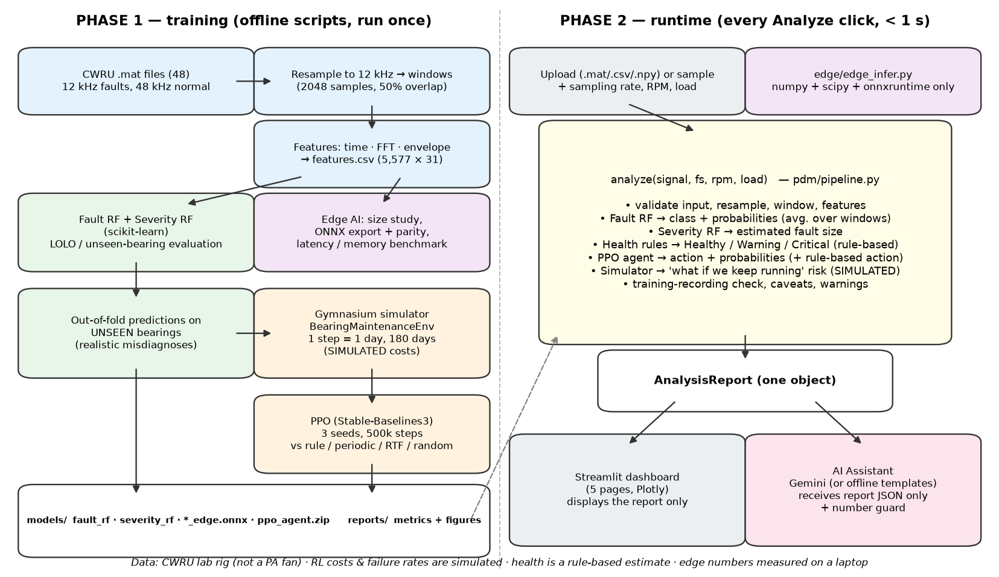
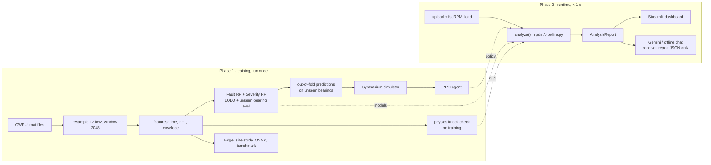

# Bearing Fault Diagnosis & Predictive Maintenance

**Edge AI · Reinforcement Learning · Conversational AI**: target application is the bearings of a power-plant
**PA (Primary Air) fan**.

The system listens to a bearing's vibration recording and:

1. **diagnoses** it: *Normal / Inner race / Outer race / Ball fault*, combining a **Random Forest** with a
   **physics check** for a clear "knock signature" at a fault's defect frequency (two independent opinions);
2. **estimates the damage size** with a second Random Forest, and turns it into a **rule-based**
   *Healthy / Warning / Critical* status;
3. **recommends an action** (continue · monitor · inspect · reduce load · stop for maintenance) using a
   **PPO reinforcement-learning agent trained in a simulator**;
4. **explains** everything in plain language (Google Gemini, or offline templates) using *only* the real results;
5. ships a **36 KB ONNX edge model** plus a standalone script that needs only NumPy, SciPy and onnxruntime;
6. shows it all in a **Streamlit dashboard**.

> **New to signals, ML or RL?** Open [`docs/guide.html`](docs/guide.html) in a browser: an interactive guide that
> explains every concept from scratch (with demos you can play with and a final quiz). It works offline.

> **Please read the limitations below.** The models are trained on CWRU **laboratory** data, not on a PA fan.
> The RL agent and every cost or risk number it uses are **simulated**. The health status is a **rule-based
> estimate**. No edge hardware was used.





**Key rule:** one function, `analyze(signal, fs, rpm, load)` in `pdm/pipeline.py`, produces an `AnalysisReport`.
The dashboard and the chat only display or explain that object, so they cannot invent results.

---

## Quick start (about 10 minutes, no training needed)

The trained models are included in the repository, so you can run the dashboard right after installing.

```powershell
git clone https://github.com/Karthik10010/bearing-health-monitor.git
cd bearing-health-monitor
py -3.11 -m venv .venv
.\.venv\Scripts\python.exe -m pip install -r requirements.txt
.\.venv\Scripts\streamlit.exe run app\Home.py
```

Your browser opens <http://localhost:8501>. Pick a bundled sample on **Home** and click **Analyze**.

The sections below explain each step in detail, plus how to get genuine test recordings, enable Gemini,
rebuild everything from scratch, run the tests, and fix common problems.

---

## 1. Prerequisites

| Need | Version | How to get it |
|---|---|---|
| **Python** | **3.11** (tested; 3.14 does **not** work yet: `onnxruntime` has no 3.14 build) | `winget install -e --id Python.Python.3.11` or the installer from <https://www.python.org/downloads/release/python-3119/> |
| **Git** | any recent | `winget install -e --id Git.Git` or <https://git-scm.com> |
| Disk space | ~2 GB | ~1.5 GB for the Python packages, ~150 MB for the CWRU data (only needed to retrain) |
| Internet | for the first install | later only for downloading CWRU data and for Gemini |

Check that Python 3.11 is available (Windows): `py -0p` should list `-V:3.11`.

Developed and tested on **Windows 11** with PowerShell. Linux/macOS commands are in section 9.

## 2. Install

```powershell
git clone https://github.com/Karthik10010/bearing-health-monitor.git
cd bearing-health-monitor

# create an isolated Python environment inside the project folder
py -3.11 -m venv .venv

# install the exact package versions (includes the small CPU-only PyTorch build)
.\.venv\Scripts\python.exe -m pip install --upgrade pip
.\.venv\Scripts\python.exe -m pip install -r requirements.txt
```

You never need to "activate" the environment: every command in this README calls `.venv\Scripts\...` directly.

Check that everything installed:

```powershell
.\.venv\Scripts\python.exe -c "import numpy, scipy, sklearn, onnxruntime, torch, stable_baselines3, streamlit; print('all OK')"
```

On a slow or unstable connection, just run the install command again if it fails: pip keeps what it already
downloaded. Adding `--retries 10 --timeout 60` helps.

## 3. Run the dashboard

```powershell
.\.venv\Scripts\streamlit.exe run app\Home.py
```

The app opens in your browser at <http://localhost:8501>. Stop it with **Ctrl+C** in the terminal.
After pulling new code, stop and start it again.

1. On **Home**, choose **Bundled sample** (or **Upload a file**: `.mat`, `.csv` with one numeric column, or `.npy`).
2. Check the **sampling rate**, **shaft speed (RPM)** and **load (HP)**. They are filled in automatically for samples.
3. Click **Analyze**. The needle gauge, diagnosis and recommended action appear right below.
4. Use the top bar to explore **Signal · Diagnosis · Maintenance · AI Assistant · Edge AI**. Every page shows the
   current recording and its rating, and your inputs stay filled in when you switch pages.

> The bundled samples are cut from CWRU recordings that the models were **trained on**. The app detects this and
> warns that the result is not an independent test (expect ~100% confidence). For a genuine test, use the
> recordings from section 4.

## 4. Download the CWRU data (for retraining and genuine tests)

```powershell
.\.venv\Scripts\python.exe scripts\01_download_data.py
```

The data is **not** included in the repository. This one command downloads it from the official CWRU Bearing
Data Center: the 48 training recordings into `data\raw\` (≈140 MB, needed to retrain), plus 4
recordings the models have **never seen** into `data\unseen\`: outer-race faults at 3 and 12 o'clock
(`144.mat`, `156.mat`, `246.mat`, `258.mat`). To test with them, choose **Upload a file** on Home and enter
**12000 Hz**, **1797 RPM**, **0 HP**.

If the CWRU website blocks scripted downloads, download the files by hand from
<https://engineering.case.edu/bearingdatacenter/download-data-file> and keep their numeric names (e.g. `105.mat`):
the training files listed in `pdm\data\cwru_catalog.py` (`CATALOG`) go into `data\raw\`, and the 4 hold-out files
(`HOLDOUT`) go into `data\unseen\`.

## 5. Enable the Gemini AI assistant (optional)

Without a key, the AI Assistant answers the 7 standard questions from templates filled with the real report
values. To enable free-form answers from Google Gemini:

1. Get an API key from Google AI Studio (<https://aistudio.google.com/apikey>).
2. Create your local settings file and paste the key after `GEMINI_API_KEY=`:
   ```powershell
   copy .env.example .env
   notepad .env
   ```
3. Check the model name in `config.yaml` (`llm.gemini_model`) and update it if Google has renamed the model.
4. Restart the dashboard. The AI Assistant page then shows **Mode: Google Gemini**.

`.env` is listed in `.gitignore`, so your key is never committed. Every answer goes through a **number guard** that
flags any number not present in the report.

## 6. Standalone edge inference

The `edge\` folder is a self-contained bundle (ONNX models + feature code) for a small device:

```powershell
.\.venv\Scripts\python.exe edge\edge_infer.py data\samples\cwru_IR007_0.npy --fs 12000 --rpm 1797
.\.venv\Scripts\python.exe edge\edge_infer.py data\unseen\144.mat --fs 12000 --rpm 1797 --json
```

On another device, copy the `edge\` folder (or download the zip from the Edge AI page) and install only
`pip install numpy scipy onnxruntime`.

## 7. Rebuild everything from scratch (optional)

Only needed to retrain the models after changing data, features or settings (`config.yaml`); the trained models
in the repository already work. Retraining **overwrites** `models\`, `reports\` and `edge\`.

The first step downloads the CWRU data automatically (section 4; if the download is blocked, put the files in
`data\raw\` by hand first). `run_all.py` runs every step below in order, then the tests.

```powershell
.\.venv\Scripts\python.exe scripts\run_all.py              # all steps + tests (~30-60 min on a laptop CPU)
.\.venv\Scripts\python.exe scripts\run_all.py --skip-rl    # keep the trained RL agent (skips PPO training only)
```

Or step by step, in this order:

| Script | What it does | Time |
|---|---|---|
| `scripts\01_download_data.py` | Downloads the CWRU recordings (`data\raw\`, `data\unseen\`) and writes the demo samples | 1-5 min |
| `scripts\02_build_features.py` | Resample, window, 37 features → `data\features\features.csv` + data checks | <1 min |
| `scripts\03_train_classifier.py` | Fault RF + severity RF, all evaluations (incl. ML + physics and the hold-out check) | 2-5 min |
| `scripts\04_edge_benchmark.py` | Size-vs-accuracy study, ONNX export + parity, benchmarks, `edge\` bundle | 3-5 min |
| `scripts\05_train_rl.py` | PPO, 3 seeds × 500k steps (`--seed N` trains one seed) | ~3-7 min per seed |
| `scripts\06_evaluate_rl.py` | PPO (with and without safety shield) vs. baselines on 1000 simulated episodes | 10-60 min |
| `scripts\07_make_figures.py` | Architecture diagram | seconds |

Each step reads the previous step's output, so run them in order. Results go to `models\` and `reports\`.
After retraining, restart the dashboard so it loads the new models.

## 8. Run the tests

```powershell
.\.venv\Scripts\python.exe -m pytest -q
```

There are 68 tests:
- synthetic-signal feature checks and loader quirks;
- leave-one-load-out (LOLO) mechanics, every health rule, the physics knock check;
- ONNX parity, and the edge script matching the main pipeline;
- the Gymnasium and SB3 environment checkers, RL behaviour checks, the safety shield;
- the chat in all 7 question types (fallback mode), the guard, and a mocked Gemini call;
- Streamlit `AppTest` smoke tests for every page, including inputs persisting across pages.

On a fresh clone, 2 edge tests are **skipped** until `scripts\01_download_data.py` has downloaded the CWRU data.

## 9. Linux / macOS

Same steps with forward slashes and `python3.11`:

```bash
python3.11 -m venv .venv
.venv/bin/python -m pip install -r requirements.txt
.venv/bin/streamlit run app/Home.py
.venv/bin/python -m pytest -q
```

(Developed on Windows; on Linux/macOS the pinned CPU-only PyTorch wheel may need
`pip install torch --index-url https://download.pytorch.org/whl/cpu` first.)

## 10. Troubleshooting

| Problem | Fix |
|---|---|
| `No matching distribution found for onnxruntime` | You are on Python 3.14 (or another unsupported version). Install Python 3.11 and recreate `.venv`. |
| Install is very slow / times out | Re-run the same command (pip resumes); add `--retries 10 --timeout 60`; try another network. |
| `py` is not recognised | Python isn't installed for Windows' launcher; install 3.11 (section 1) or use the full path to `python.exe`. |
| Port 8501 already in use | Another dashboard is running. Stop it with Ctrl+C, or run on another port: `... run app\Home.py --server.port 8502` |
| Dashboard shows an old version / import error after an update | Stop the server (Ctrl+C) and start it again. |
| "Could not analyse the file" on upload | Check the format: `.mat` with one `*_DE_time` variable or a single vector, `.csv` with one numeric column (or a column named `signal`), `.npy` with a 1-D array; at least 0.2 s of signal. |
| Strange diagnosis on your own data | Check the sampling rate and RPM you entered. The models are trained on a 6205 bearing at ~1720-1800 RPM; the app warns when inputs are outside that range. |
| AI Assistant still says "offline templates" | `.env` must be in the project folder with `GEMINI_API_KEY=...`; restart the dashboard after adding it. |
| Scripted CWRU download fails | Download manually (section 4). |

---

## 11. Results (CWRU drive-end 6205 bearing, 48 recordings, 5,577 windows)

### Fault type: how strict the exam is changes the score

| Evaluation | What it tests | Window macro-F1 (ML) | Recordings correct |
|---|---|---|---|
| Random window split (**leaky**) | windows of the same recording on both sides | 1.000 | – |
| **Leave-one-load-out** (plan's main test) | train on 3 loads, test on the 4th | **0.997 ± 0.005** | 100% |
| **Unseen bearings** (leave-one-fault-size-out), ML only | bearings never seen at any load | **0.553 ± 0.241** | 58% |
| **Unseen bearings, ML + physics check** | same test, final decision | – | **75%** |
| **Independent hold-out**: 4 CWRU recordings never used for anything | outer race @3 / @12 o'clock | – | ML 2/4, **ML + physics 4/4** |

**Why the gap between seen and unseen bearings:** CWRU recorded each damaged bearing at all four loads, so
leave-one-load-out still shows the model the *same physical bearing*. The first model (all 31 original features)
learned to recognise bearings by their overall vibration *size* and scored only 0.462 / 37% on unseen bearings.

**What improved it** (choices made on the unseen-bearing test with a rule fixed in advance; the hold-out was only
looked at afterwards):
1. The fault-type model no longer uses absolute vibration size (mean, std, RMS, min, max, peak-to-peak), which
   depends on the individual bearing and machine, and gained 6 scale-free **"which knock dominates"** features
   (shares and log-ratios of the BPFO / BPFI / BSF envelope peaks): 0.462 → 0.553 macro-F1, 37% → 58% recordings.
2. A **physics knock check** (`pdm/physics.py`, no training): when one fault family's envelope peak is ≥ 5× the
   background and ≥ 1.5× the next family, it names the fault. On CWRU it spoke on 19 of 48 recordings, **all 19
   correct**; otherwise the ML model decides. When the two disagree, the dashboard says so and flags low confidence.

Healthy vs damaged stays reliable on unseen bearings (100% of healthy windows correct). Some CWRU recordings simply
show no clear defect signature (outer race 0.014″, inner race 0.028″, most ball faults), which limits any method.

Feature groups (fault-type model) under LOLO: time-shape 0.692 · frequency 0.976 · envelope+ratios 0.757 · all
0.997. On unseen bearings: 0.171 · 0.369 · 0.385 · 0.553.

### Fault size (severity RF, trained on faulty windows only)

| Evaluation | Window macro-F1 |
|---|---|
| Leave-one-load-out | 0.997 |
| Unseen fault type (train on 2 types, test on the 3rd) | 0.128 (chance ≈ 0.25) |

The severity model keeps the vibration-size features (bigger cracks do knock harder). Even so, size estimates do
**not** transfer to an unseen fault type with any feature set tried (0.05–0.18), so treat size and the health
status as rough, rule-based estimates.

### Edge AI (measured on the development laptop, Windows CPU, **not edge hardware**)

| | Full model | Edge model |
|---|---|---|
| Trees / depth | 100 / unlimited | **10 / 8** |
| ONNX size | 401 KB | **36 KB** |
| LOLO macro-F1 | 0.997 | 0.997 |
| Unseen-bearing macro-F1 (ML only) | 0.553 | 0.494 |
| ONNX inference per window | 0.020 ms | 0.013 ms |
| Features + inference per window | – | ≈4.2 ms (median) |
| Whole 10 s recording | – | ≈59 ms |

The edge script also applies the physics knock check, so it gives the same final diagnosis as the dashboard.

ONNX and scikit-learn agree on **all 5,577 windows** (max probability difference below 1e-6). The edge model
agrees with the full model on every window.

### Reinforcement learning (SIMULATION, illustrative costs, 1000 test episodes of 180 days)

| Policy | Mean reward | Breakdowns / episode | Availability |
|---|---|---|---|
| **PPO agent + safety shield** (what the dashboard recommends) | **1,597** | **0.00** | **95.4%** |
| PPO agent alone (best of 3 seeds, picked on validation episodes) | 1,622 | 0.00 | 96.0% |
| Rule-based (health rules) | 1,535 | 0.08 | 91.5% |
| Periodic replacement (every 30 days, tuned) | 1,080 | 0.25 | 72.8% |
| Run-to-failure | 451 | 0.93 | 41.4% |
| Random | −583 | 0.00 | 43.1% |

Compared on the same episodes: shielded agent minus rule-based = **+62 per episode (95% CI +42 to +81)**;
unshielded agent minus rule-based = +86 (+66 to +107). The rules win slightly more individual episodes (57% for
the shielded agent), usually by small margins, but they cause breakdowns (−300 each) that the agent avoids. All three
training seeds now beat the rule-based policy (1,622 / 1,571 / 1,549; before the diagnosis improvement they were
1,642 / 1,381 / 777).

The simulated agent observes diagnoses produced exactly like the dashboard's (ML + physics check), sampled from
the classifier's **unseen-bearing** results, so it trains with realistic mistakes.

**Safety shield** (decided with the project owner): fault-*size* estimates are unreliable on unseen bearings, so
in the simulator most "Critical" readings are false alarms, and the agent learned to treat a Critical label alone
as weak evidence and often keep running (zero breakdowns in simulation, but e.g. "Continue" for the genuine
never-seen fault `data/unseen/258.mat`). That is not acceptable as advice, so on a **Critical** rating the agent may
not recommend "Continue" or "Monitor"; the rule-based action is used instead and the dashboard says so
(`pdm/rl/agent.py`, `config.yaml → rl.safety_shield`). Cost in simulation: about 1.5% reward, still 0 breakdowns.

All plots are in `reports/figures/` and all numbers in `reports/metrics/`.

---

## 12. Limitations

1. Trained and tested only on **CWRU lab data** (2 HP motor test rig), **not on a real PA fan**. Fans have
   different speeds, structures, sensors and noise, so retraining and validation on fan data would be needed.
2. CWRU faults are **artificially machined**, not naturally grown. Each fault type and size is **one physical
   bearing**, which limits how well the models generalise (see the unseen-bearing results).
3. The RL agent is trained in a **simulation** with **assumed** costs, wear rates and failure probabilities
   (`config.yaml → rl`). Its decisions demonstrate the method; they are not a validated plant policy.
4. **No edge hardware** was used. The edge numbers were measured on a laptop.
5. The health status and the gauge's needle position are a **rule-based estimate** (`config.yaml → health`);
   fault-size estimates do not transfer to unseen fault types.
6. Gemini needs internet access and an API key. Without them the chat uses template answers.

## 13. Project layout

```
pdm/            core package (no UI): data/, signal/, ml/, edge/, rl/, llm/, health.py, pipeline.py
scripts/        01-07 + run_all.py
app/            Streamlit dashboard (Home.py = top navigation, views/ = pages, components/)
edge/           standalone edge bundle (edge_infer.py + ONNX + config)
data/           raw/ + unseen/ (downloaded by script 01, not committed), features/ (rebuilt by
                script 02, not committed), samples/ (demo recordings, committed)
models/         trained models (.joblib, .onnx, .zip) + model cards (.json)
reports/        figures/ (PNG) and metrics/ (JSON/CSV)
tests/          pytest suite
docs/           guide.html - interactive guide to every concept (open in a browser)
config.yaml     every setting: windows, RF, health rules, RL costs, Gemini model
```
